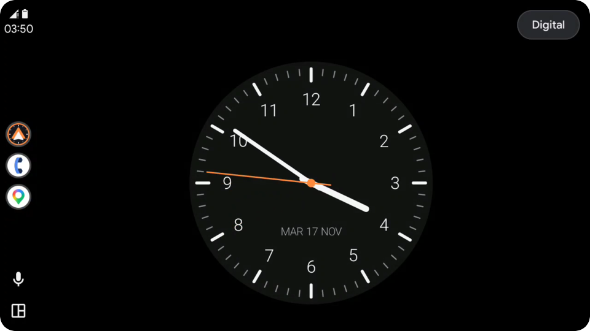
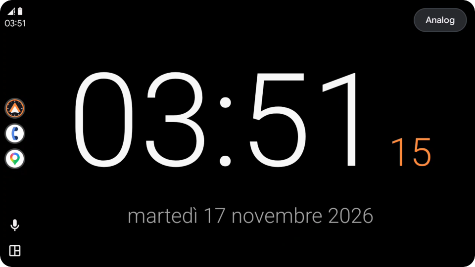

<p align="center">
  
</p>

<h1 align="center">DashGlance Clock</h1>

<p align="center">Open-source clock for Android Auto with easy-to-read faces and presets</p>

<p align="center">
  <a href="LICENSE"></a>
  <a href="https://github.com/FilipNone/DashGlance-Clock/releases/latest"></a>
  <a href="https://kotlinlang.org"></a>
</p>

<p align="center">
  <a href="#showcase">Showcase</a> ·
  <a href="#features">Features</a> ·
  <a href="#installation">Installation</a> ·
  <a href="#contributing">Contributing</a> ·
  <a href="#license">License</a>
</p>

> [!NOTE]
> DashGlance Clock is a proof of concept. Android Auto has no proper place for a clock yet, so this app borrows the music card and the navigation screen. Expect rough edges until Android Auto opens up features like dashboard widgets.

## Showcase

<p align="center">
  
</p>
<p align="center">
  
  
</p>

Screenshots from Google's Desktop Head Unit. Top: the card next to Google Maps. Bottom: the full-screen faces.

## Features

- The time and date in the music card next to the map, with the song playing on your phone
- Play/pause, next and previous for whichever music app is playing
- Full-screen analog and digital faces with seconds
- 12- or 24-hour time from your phone settings, and the date in your language
- No internet access, ads or tracking

Android Auto shows one DashGlance icon for both the card and the full-screen clock, and picks which one opens.

## Installation

<a href="https://github.com/FilipNone/DashGlance-Clock/releases/latest"></a>
<!-- Uncomment once the app is on F-Droid.
<a href="https://f-droid.org/packages/com.filipnone.dashglanceclock/"></a>
-->

1. Download the APK from the [latest release](https://github.com/FilipNone/DashGlance-Clock/releases/latest) and install it on your phone. It needs Android 8.0 or newer.
2. Android Auto hides apps that don't come from Google Play, so turn on its developer settings: open Android Auto's settings, tap Version 10 times, and confirm.
3. In the ⋮ menu, open Developer settings and turn on Unknown sources.
4. Open DashGlance on your phone and tap Allow music controls. The app uses this access to see and control your music app, and ignores your notifications.
5. Connect to your car. DashGlance Clock is in the Android Auto app list.

While no car is connected, Android Auto's "Customize launcher" screen on the phone won't list the app. That's expected.

## Contributing

Bug reports, ideas and pull requests are welcome in [Issues](https://github.com/FilipNone/DashGlance-Clock/issues). [AGENTS.md](AGENTS.md) has a map of the code.

You need JDK 17 or newer and the Android SDK with platform 37.

```sh
./gradlew installDebug                 # build and install on a connected phone
./gradlew testDebugUnitTest lintDebug  # tests and lint
```

To see the car screen without a car, install the [Desktop Head Unit](https://developer.android.com/training/cars/testing/dhu), turn on Unknown sources as above, and run `scripts/dhu.sh --usb`. [docs/android-auto.md](docs/android-auto.md) covers the problems you may hit.

## License

[MIT](LICENSE). Made by [FilipNone](https://github.com/FilipNone).

Android Auto is a trademark of Google LLC. This project isn't affiliated with or endorsed by Google.
