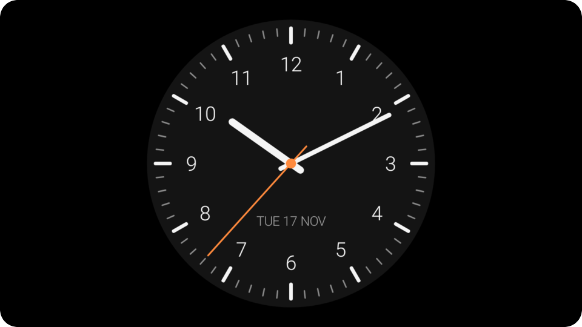
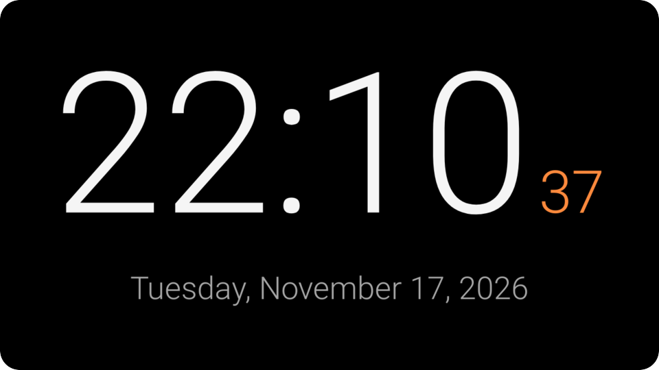
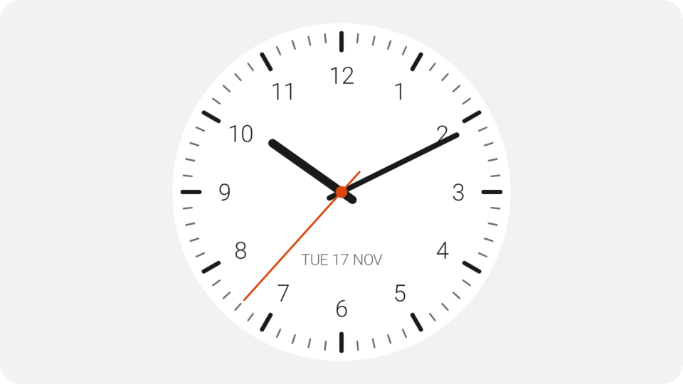
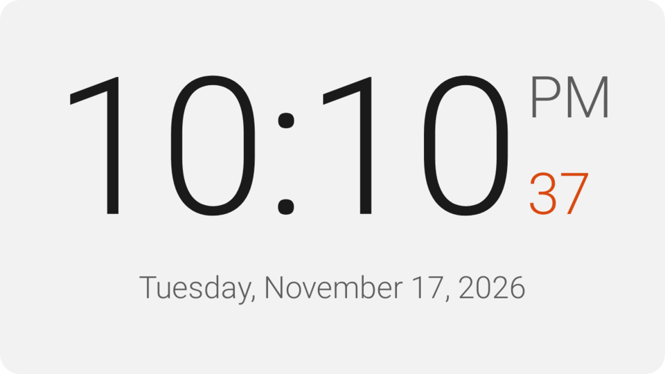

<p align="center">
  
</p>

<h1 align="center">DashGlance Clock</h1>

<p align="center">Open-source clock for Android Auto with easy-to-read faces and presets</p>

<p align="center">
  <a href="LICENSE"></a>
  <a href="https://github.com/FilipNone/DashGlance-Clock/releases/latest"></a>
  <a href="https://kotlinlang.org"></a>
</p>

<p align="center">
  <a href="#showcase">Showcase</a> ·
  <a href="#features">Features</a> ·
  <a href="#installation">Installation</a> ·
  <a href="#contributing">Contributing</a> ·
  <a href="#license">License</a>
</p>

## Showcase

<p align="center">
  
  
</p>
<p align="center">
  
  
</p>

The car screen at night (top) and during the day (bottom), drawn by the app's renderer at 1280 × 720.

## Features

- Analog and digital faces that fill the car screen
- Seconds and the date, updated every second
- Colors that switch with the car's day and night mode
- One button to switch faces; the phone app keeps the same choice
- 12- or 24-hour time from your phone settings, and the date in your language
- No internet permission, ads or tracking

## Installation

<a href="https://github.com/FilipNone/DashGlance-Clock/releases/latest"></a>
<!-- Uncomment once the app is on F-Droid.
<a href="https://f-droid.org/packages/com.filipnone.dashglanceclock/"></a>
-->

1. Download the APK from the [latest release](https://github.com/FilipNone/DashGlance-Clock/releases/latest) and install it on your phone. It needs Android 8.0 or newer.
2. Android Auto hides apps that don't come from Google Play, so turn on its developer settings: open Android Auto's settings, tap Version 10 times, and confirm.
3. In the ⋮ menu, open Developer settings and turn on Unknown sources.
4. Connect to your car. DashGlance Clock is in the Android Auto app list.

While no car is connected, Android Auto's "Customize launcher" screen on the phone won't list the app. That's expected.

## Contributing

Bug reports, ideas and pull requests are welcome in [Issues](https://github.com/FilipNone/DashGlance-Clock/issues). [AGENTS.md](AGENTS.md) has a map of the code.

You need JDK 17 or newer and the Android SDK with platform 37.

```sh
./gradlew installDebug                 # build and install on a connected phone
./gradlew testDebugUnitTest lintDebug  # tests and lint
```

To see the car screen without a car, install the [Desktop Head Unit](https://developer.android.com/training/cars/testing/dhu), turn on Unknown sources as above, and run `scripts/dhu.sh --usb`. [docs/android-auto.md](docs/android-auto.md) covers the problems you may hit.

## License

[MIT](LICENSE). Made by [FilipNone](https://github.com/FilipNone).

Android Auto is a trademark of Google LLC. This project isn't affiliated with or endorsed by Google.
