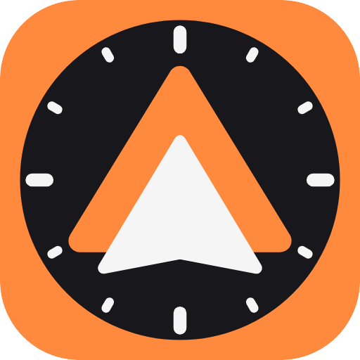
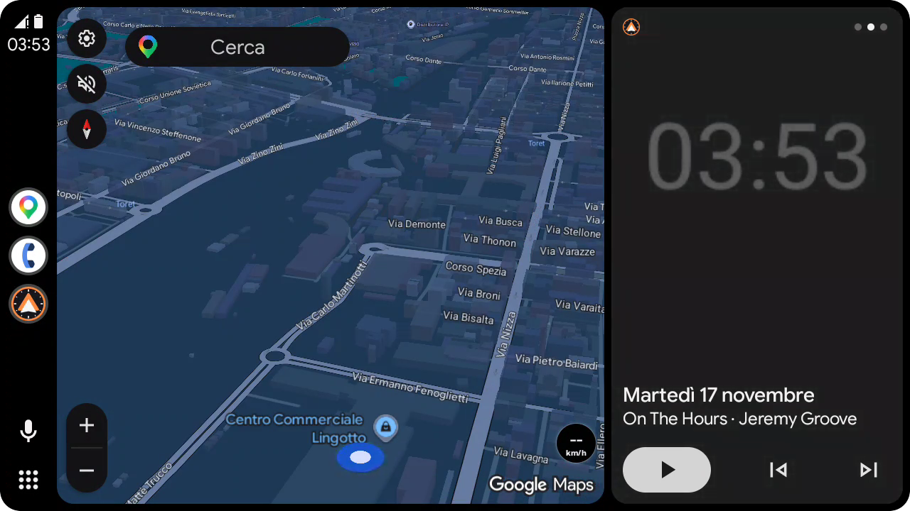
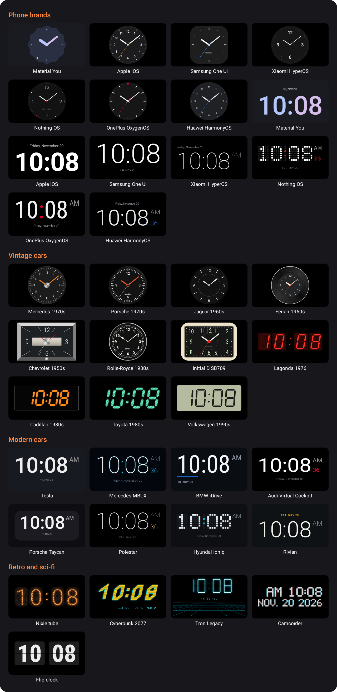

<p align="center">
  
</p>

<h1 align="center">DashGlance Clock</h1>

<p align="center">Open-source clock for Android Auto with easy-to-read faces and presets</p>

<p align="center">
  <a href="LICENSE"></a>
  <a href="https://github.com/FilipNone/DashGlance-Clock/releases/latest"></a>
  <a href="https://kotlinlang.org"></a>
</p>

<p align="center">
  <a href="#showcase">Showcase</a> ·
  <a href="#features">Features</a> ·
  <a href="#installation">Installation</a> ·
  <a href="#contributing">Contributing</a> ·
  <a href="#license">License</a>
</p>

> [!NOTE]
> DashGlance Clock is a proof of concept. Android Auto has no proper place for a clock yet, so its two apps borrow the music card and the navigation screen. Expect rough edges until Android Auto opens up features like dashboard widgets.

## Showcase

<p align="center">
  
</p>

Screenshots from Google's Desktop Head Unit. Top: the card next to Google Maps. Bottom: the full-screen faces.

<p align="center">
  
  
</p>

<p align="center">
  
</p>

The other designs you can pick on your phone, as the car draws them. [docs/designs.md](docs/designs.md) says what each one is based on.

## Features

DashGlance comes as two apps. Install the one you need, or both:

| App | Icon | What it does |
|---|---|---|
| DashGlance Card | clock dial with music notes | The time and date in the music card next to the map, with the song playing on your phone. Play/pause, next and previous go to whichever music app is playing. Pick from 30 designs on your phone; digital ones can be stacked. |
| DashGlance Clock | clock dial with the Android Auto mark | Full-screen analog and digital faces with seconds, in 40 designs you pick on your phone: Modern clocks, Vintage clocks, Retro and Sci-Fi ([docs/designs.md](docs/designs.md)). |

Both use 12- or 24-hour time from your phone settings and the date in your language. Neither has internet access, ads or tracking.

DashGlance Card works in a car. DashGlance Clock only shows up on test head units like Google's Desktop Head Unit for now: in a car, Android Auto blocks full-screen apps that weren't installed from Google Play, and its Unknown sources setting doesn't cover them. [docs/android-auto.md](docs/android-auto.md) has the details.

## Installation

<a href="https://github.com/FilipNone/DashGlance-Clock/releases/latest"></a>
<!-- Uncomment once the app is on F-Droid.
<a href="https://f-droid.org/packages/com.filipnone.dashglanceclock/"></a>
-->

1. Download from the [latest release](https://github.com/FilipNone/DashGlance-Clock/releases/latest) and install on your phone: `DashGlance-Card-*.apk` for the card next to the map, `DashGlance-Clock-*.apk` for the full-screen clock. They need Android 8.0 or newer.
2. Android Auto hides apps that don't come from Google Play, so turn on its developer settings: open Android Auto's settings, tap Version 10 times, and confirm.
3. In the ⋮ menu, open Developer settings and turn on Unknown sources.
4. Open DashGlance Card on your phone and turn on Allow music controls. The first time, Android asks you to give it notification access. The app uses it to see and control your music app, and ignores your notifications. Turning the switch off later stops the app from using the access; to remove the access itself, turn it off in Android's notification access settings.
5. Pick a clock: tap the preview for analog or digital, then choose a design below it.
6. Connect to your car. DashGlance Card is in the Android Auto app list, with music notes on its icon. With music controls on, the card next to the map shows the clock while your music plays and keeps it when you pause. Without them, your music app takes the card whenever it plays.

If DashGlance Card is missing from the car's app list, check step 3 first: without Unknown sources, Android Auto hides it.

While no car is connected, Android Auto's "Customize launcher" screen on the phone won't list the apps. That's expected.

Updating from 0.2: install DashGlance Card over the old app. It replaces it and keeps your music controls setting. Your old designs don't carry over to the card. DashGlance Clock is a separate install and starts with the default designs.

## Contributing

Bug reports, ideas and pull requests are welcome in [Issues](https://github.com/FilipNone/DashGlance-Clock/issues). [AGENTS.md](AGENTS.md) has a map of the code.

You need JDK 17 or newer and the Android SDK with platform 37.

```sh
./gradlew installCardDebug installFullscreenDebug  # build and install both apps on a connected phone
./gradlew test lintCardDebug lintFullscreenDebug   # tests and lint
```

Both apps come from the one `app` module as the product flavors `card` and `fullscreen`.

To see the car screen without a car, install the [Desktop Head Unit](https://developer.android.com/training/cars/testing/dhu), turn on Unknown sources as above, and run `scripts/dhu.sh --usb`. [docs/android-auto.md](docs/android-auto.md) covers the problems you may hit.

## License

[MIT](LICENSE). Made by [FilipNone](https://github.com/FilipNone).

Android Auto is a trademark of Google LLC. This project isn't affiliated with or endorsed by Google. Phone, car, film and game names in the design list belong to their owners and only say what inspired a design. None of these companies is involved with this project.
